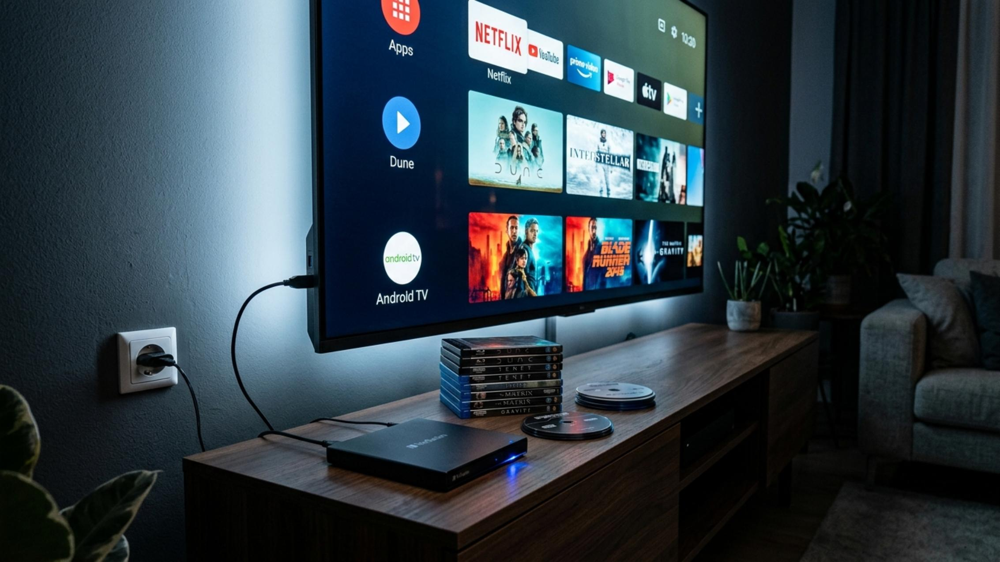

# BD DVD CD DiscMount
Mounts USB DVD/Blu-ray drives on Android / Google TV **without kernel drivers**: communicates SCSI/MMC directly over USB (Bulk-Only Transport) and reads UDF / ISO9660 in user space. Sata to USB too. 

<p align="center">
  
  <br>
[](LICENSE)


**Play and browse CDs, DVDs and Blu-ray discs from a USB optical drive on Android TV / Google TV — no kernel drivers, no root.**

DiscMount talks SCSI/MMC directly to the drive over USB (Bulk-Only Transport) and reads UDF / ISO 9660 in user space, in the spirit of
MLUSB Mounter. Playback is handled by LibVLC. The whole interface is remote-control (D-pad) friendly.

> **Legal notice:** DiscMount is meant for discs **you own**. Handling copy-protected discs (CSS / AACS) may be restricted by law where you live.
> No keys are included or downloaded. Please read [`DISCLAIMER.md`](DISCLAIMER.md) before using or building it.


VIDEO DEMO https://youtu.be/kLmdMa___uI?si=bYNfJQtAp-3qLaYO

## Features

- **Drive support:** detects USB optical drives (Mass Storage, SCSI transparent command set, Bulk-Only), asks for USB permission, waits for the disc and identifies its type (CD / DVD / BD).
- **File systems:** ISO 9660 (+ Joliet) and UDF 1.02–2.60, including the Blu-ray **metadata partition**.
- **Disc detection:** shows whether the disc is an audio CD, data CD, DVD-Video, data DVD, Blu-ray video or data Blu-ray, with original disc artwork (not the official logos).
- **Audio CDs:** TOC and CD-TEXT, tracks read with `READ CD` and streamed as WAV on the fly, with playlist, next/previous.
- **Audio files:** mp3, flac, wav, ogg, m4a, aac, opus, ape, wv, dsf/dff and more, with a folder playlist.
- **Video and images:** built-in LibVLC player and image viewer; file browser with copy-to-storage (long press).
- **DVD-Video (CSS):** *Play DVD movie* picks the longest title set in `VIDEO_TS` and plays it through [libdvdcss](https://www.videolan.org/developers/libdvdcss.html).
- **Blu-ray (AACS):** *Play Blu-ray movie* picks the main playlist and decrypts `.m2ts` streams on the fly using **your own `KEYDB.cfg`** (see below).
- **Files app integration:** a `DocumentsProvider` exposes the mounted disc to Android's file picker, so VLC and other apps can open files on it.
- **11 interface languages:** English (default), Français, Deutsch, 日本語, Español, Italiano, Nederlands, Português, 한국어, Русский, Català. Tap the flag at the top right to switch.

## Blu-ray and `KEYDB.cfg`

1. Tap **Import KEYDB.cfg** and pick your key file, or copy it to `/sdcard/Android/data/dev.discmount/files/KEYDB.cfg` (for example with `adb push`).
2. Insert the disc and mount the drive. DiscMount computes the disc hash (SHA-1 of `AACS/Unit_Key_RO.inf`) and looks it up in your file.
3. If the entry contains a **VUK** (`V`) or **unit keys** (`U`), the streams are decrypted on the fly and the disc plays.

Limitations:

- Only entries with a VUK or unit keys work. Entries with only a media key (`M`/MEK) do not, because there is no AACS drive authentication.
- No BD+ and no Ultra HD Blu-ray (AACS 2.0) support.
- The AACS code is original and was tested with synthetic data and on real Blu-ray discs by the author; coverage of all disc types is not guaranteed.
- DiscMount ships **no keys**. You are responsible for obtaining a key file lawfully, for discs you own.

## Requirements

- An Android TV / Google TV device (Android 8.0+, `minSdk` 26) with USB host support.
- A USB DVD/Blu-ray drive that works as a standard Mass Storage (Bulk-Only) device. Drives that need extra power may require a powered USB hub or a drive with its own supply.
- To build: JDK 17, Android SDK (compileSdk 35) and NDK/CMake (for the CSS bridge), or just a GitHub account and Actions.

## Building

### GitHub Actions (no local setup)

Fork or push this repository to GitHub. The workflow [`.github/workflows/build-apk.yml`](.github/workflows/build-apk.yml) runs the core tests, downloads libdvdcss
and builds `app-debug.apk` (*Actions → latest run → Artifacts → `DiscMount-debug-apk`*).

### Android Studio / Gradle

```sh
sh tools/fetch_libdvdcss.sh     # downloads libdvdcss (pinned commit) and applies the DiscMount patch
gradle :app:assembleDebug       # or open the folder in Android Studio and run "app"
adb install app/build/outputs/apk/debug/app-debug.apk
```

`tools/fetch_libdvdcss.sh` is required: libdvdcss is **not** stored in this repository.

### Core tests (no Android needed)

```sh
pip install pycdlib
tools/run_core_tests.sh
```

This builds the pure-Kotlin core, generates ISO / Joliet / UDF test images, reads them through a fake USB device and checks the SHA-256 of every file.
The AACS, `KEYDB.cfg` and Blu-ray playlist parsers are covered by synthetic tests in `core/src/test/kotlin/dev/discmount/core/AacsTest.kt`.

## Project layout

| Path | Contents |
|---|---|
| `core/` | Pure Kotlin/JVM (no Android): block devices, UDF/ISO 9660, USB Bulk-Only transport, SCSI/MMC commands, CD audio, AACS + `KEYDB.cfg` + MPLS parsing |
| `app/` | Android app: activities, USB transport, player, `DocumentsProvider`, i18n/flags, JNI bridge |
| `app/src/main/cpp/` | CMake build, JNI bridge and SCSI-over-USB replacement for libdvdcss's `ioctl.c` |
| `tools/` | libdvdcss fetch script, test image generator, test runner |

## Known limitations

- Bulk-Only Transport only (no UAS); no UDF virtual partitions (VAT), Rock Ridge or sparable-sector remapping.
- SACD discs cannot be played (protected format); `.dsf`/`.dff` files can, if LibVLC supports them.
- Disc menus are not supported: DVD and Blu-ray play the main title directly.
- `AndroidUsbTransport.CHUNK` (16 KiB) can be raised for more speed on drives that allow it.
- Real-world testing so far is limited; expect rough edges with some drives. Issues and pull requests are welcome.

## Contributing

Bug reports and pull requests are welcome. Please do **not** post keys, `KEYDB.cfg` files, host certificates or links to them in issues or pull requests.
By contributing you agree that your contribution is licensed under GPL-3.0-or-later, like the rest of the project.

## License

DiscMount is free software: you can redistribute it and/or modify it under the terms of the **GNU General Public License as published by the
Free Software Foundation, either version 3 of the License, or (at your option) any later version**. See [`LICENSE`](LICENSE).

The app links against **libdvdcss** (GPL-2.0-or-later) and **LibVLC** (LGPL-2.1-or-later), so a built APK is a GPL work: if you distribute it, you must
also make the corresponding source available. Third-party components and trademarks are listed in [`THIRD_PARTY_NOTICES.md`](THIRD_PARTY_NOTICES.md).
Legal and usage notes are in [`DISCLAIMER.md`](DISCLAIMER.md).

DiscMount is provided without any warranty and is not affiliated with VideoLAN, Google, the DVD Forum, the Blu-ray Disc Association or AACS LA.
